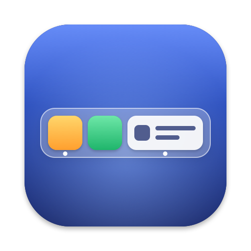
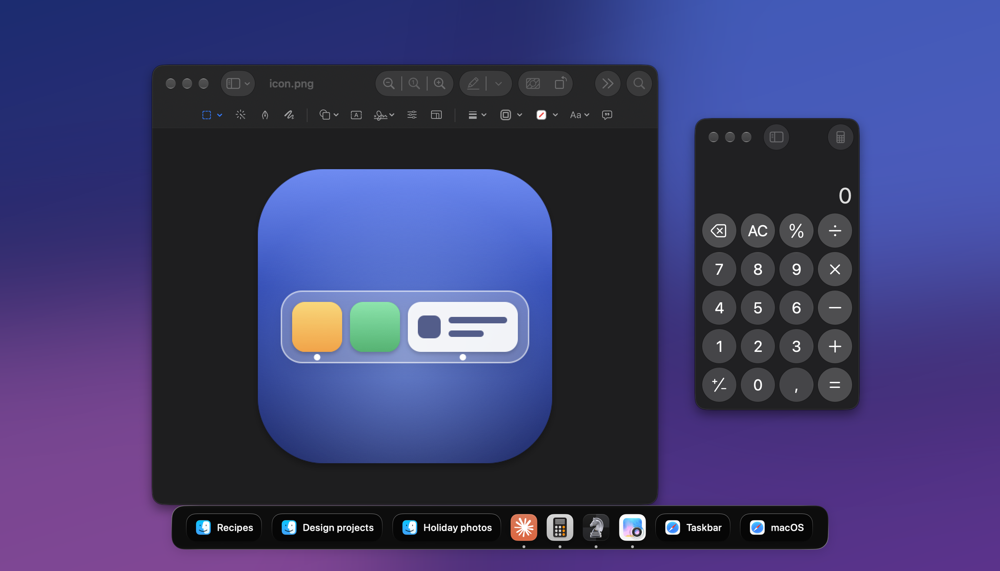
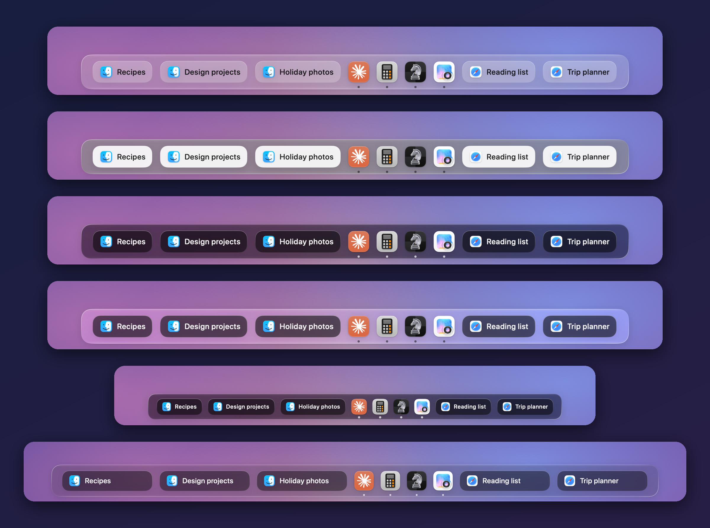
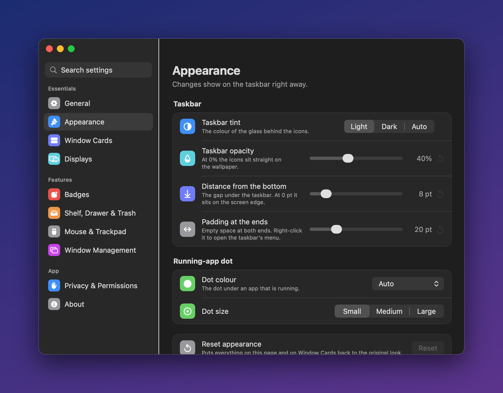

<p align="center">
  
</p>

<h1 align="center">NitiaDock</h1>

<p align="center">
  <strong>A taskbar for your Mac. Every window gets a card. One click and you are there.</strong>
</p>

<p align="center">
  <a href="https://github.com/Tripchipp/nitiadock/releases/latest"></a>
  
  
  <a href="LICENSE"></a>
</p>

<p align="center">
  
</p>

The Dock shows apps. NitiaDock shows **windows**. If you have three Finder windows and two Safari
windows, you see five cards with their titles, so you can go straight to the one you want instead
of guessing, cycling or opening Mission Control. Apps with a single window stay a tidy icon.

<table>
  <tr>
    <td align="center" width="25%">🔒<br /><strong>Private</strong><br />Window titles never leave your Mac</td>
    <td align="center" width="25%">🚫<br /><strong>No tracking</strong><br />No analytics, telemetry or account</td>
    <td align="center" width="25%">✅<br /><strong>Notarized</strong><br />Signed by a Developer ID, checked by Apple</td>
    <td align="center" width="25%">💸<br /><strong>Free</strong><br />Open source under the GPL</td>
  </tr>
</table>

## Download

**[Download NitiaDock for macOS](https://github.com/Tripchipp/nitiadock/releases/latest)** (the `.dmg` file).

Open the disk image, drag NitiaDock to Applications and open it. NitiaDock asks for Accessibility
permission once, so it can see your windows and bring them forward, and then suggests hiding the
Dock. It is signed with a Developer ID and notarized by Apple, and it can update itself.

Or with [Homebrew](https://brew.sh):

```bash
brew install --cask tripchipp/tap/nitiadock
```

Requires macOS 12 Monterey or later, on Apple silicon or Intel.

## What it does

<table>
  <tr>
    <td width="50%" valign="top">
      <h3>One card per window</h3>
      Click a card to bring its window forward. Click again to minimize it. Minimized windows and
      hidden apps stay on the taskbar with a greyed title, and windows on other Spaces are listed
      too: clicking one takes you there.
    </td>
    <td width="50%" valign="top">
      <h3>Looks the way you want</h3>
      Light, dark or follow-the-system, any opacity from solid glass to nothing at all. Card width,
      corner radius, title size and spacing are all yours. Every change shows up live.
    </td>
  </tr>
  <tr>
    <td valign="top">
      <h3>Unread badges</h3>
      Chat apps show their unread count on the taskbar, and you can add any other app, such as Mail
      or Outlook.
    </td>
    <td valign="top">
      <h3>Several displays</h3>
      One taskbar that follows the pointer, one pinned to a display, or a taskbar on every display
      that lists only that display's windows.
    </td>
  </tr>
  <tr>
    <td valign="top">
      <h3>Stays out of the way</h3>
      Auto-hide with the delay you choose, a shortcut to show and hide it, and no flash when a
      window goes full screen.
    </td>
    <td valign="top">
      <h3>Small things that add up</h3>
      Middle-click Finder or a browser for a new window, drag cards to reorder them, keep apps on
      the taskbar, a shelf for files and a drawer for apps you rarely use.
    </td>
  </tr>
</table>

## Make it yours

Liquid Glass, light, dark or no background at all. Small or extra large. Cards that fit their
title or all the same width. Every option applies live, so you see it on the taskbar while you
move the slider.

<p align="center">
  
</p>

Settings are laid out like System Settings, with a search field and a plain sentence under every
option, so you never have to guess what a switch does.

<p align="center">
  
</p>

## Privacy

NitiaDock can see every window title on your Mac, so it is built to keep them there.

- **Window titles stay on your Mac.** NitiaDock reads window titles and app names to draw the
  cards. They are never written to disk or sent anywhere.
- **One small local history.** To sort the recent documents in an app's right-click menu,
  NitiaDock keeps the paths of documents you opened, per app, in
  `~/Library/Application Support/no.thilip.nitiadock/document-usage.json`. Only your user account
  can read the file, it never leaves your Mac, and deleting it only resets that sorting.
- **No analytics and no account.** There is no tracking, no telemetry and nothing to sign up for.
- **One optional connection.** The update check is the only network request NitiaDock makes, and
  only if you allow it on the second launch. It asks GitHub whether there is a newer version and
  sends nothing about you or your Mac.
- **Permissions you can see.** Accessibility lets it list your windows and bring them forward.
  macOS asks separately before it previews a Finder folder or empties the Trash. Settings >
  Privacy & Permissions shows both.
- **Nothing hidden.** The full source is here, and a test fails the build if a networking API appears
  anywhere outside the updater.

## Questions

**Why does it need Accessibility permission?**
That is the macOS permission that lets an app see other apps' windows and bring them forward. The
taskbar cannot work without it. You can turn it off any time in System Settings > Privacy &
Security > Accessibility.

**Where did my Dock go?**
On first launch NitiaDock suggests hiding the Dock, since the two do the same job. Press ⌥⌘D at any
time to show or hide it, or open Settings > General > Restore the Dock to undo the changes.

**How do I uninstall it?**
Open Settings > General > Restore the Dock, quit NitiaDock, and move it from Applications to the
Trash. Its settings live in `~/Library/Preferences/no.thilip.nitiadock.plist` if you want them gone
too.

**Is it free?**
Yes. NitiaDock is free and open source under the GPL. It is a hobby project made by one person, so
please be patient with bug reports.

## Feedback

Found a bug or have an idea? Use **Settings > About > Send Feedback**, which opens a GitHub issue
with your version filled in, or [open an issue](https://github.com/Tripchipp/nitiadock/issues/new/choose)
directly. Questions are welcome in [Discussions](https://github.com/Tripchipp/nitiadock/discussions).

## Build from source

You need Xcode 26 or later and an Apple Development certificate (Xcode > Settings > Accounts, add
your Apple ID, then Manage Certificates > + > Apple Development).

```bash
git clone https://github.com/Tripchipp/nitiadock.git
cd nitiadock
Scripts/install_local_release.sh
open /Applications/NitiaDock.app
```

The script builds Release, signs it with your certificate and installs it to `/Applications`. For
development, `Scripts/build_and_run.sh` builds Debug and relaunches. Tests:

```bash
xcodebuild test -project NitiaDock.xcodeproj -scheme NitiaDock \
  -derivedDataPath build/TestDD -destination 'platform=macOS' CODE_SIGNING_ALLOWED=NO
```

Keep `build/TestDD` for tests: a test run re-signs the app, and doing that to the build you launch
breaks its Accessibility permission. Releases are made with `Scripts/release.sh`, see
[CONTRIBUTING.md](CONTRIBUTING.md).

## Credits

NitiaDock is based on [Tungsten Edge](https://github.com/moonbai-studio/tungsten-edge) by Moonbai
Studio, which does the hard part: knowing which window is which, keeping cards from jumping around
and making a click do what you expect. NitiaDock adds its own design, settings and features on top,
and no longer tracks upstream.

"Tungsten Edge" and its logo are trademarks of Moonbai Studio and are not used by NitiaDock (see
[TRADEMARK.md](TRADEMARK.md)). NitiaDock is not affiliated with or endorsed by Moonbai Studio.

Licensed under [GPL-3.0-or-later](LICENSE). Updates use [Sparkle](https://sparkle-project.org) (MIT).
